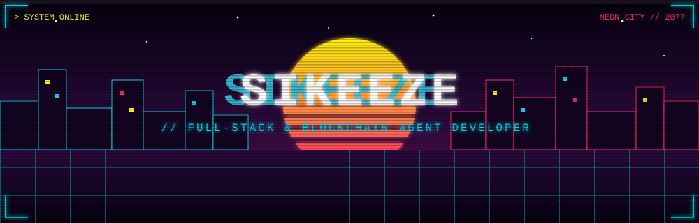
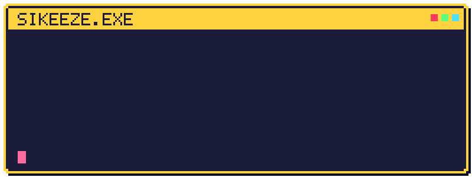
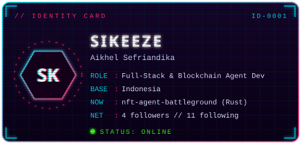
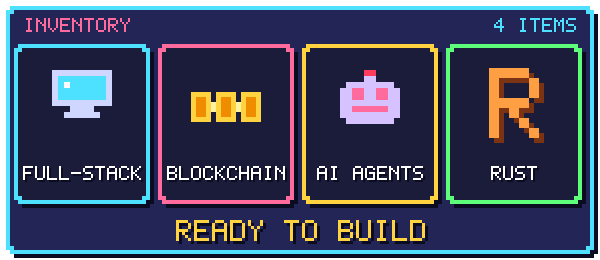
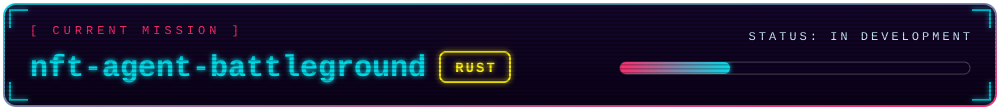
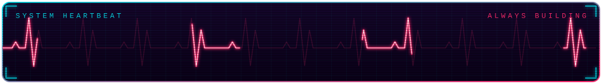
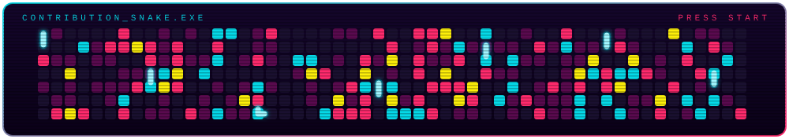
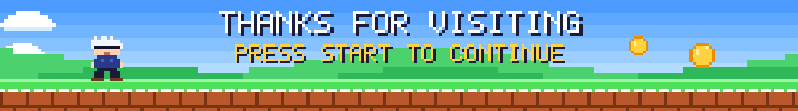

 

## 🎮 `PLAYER SELECT`

  

 

- 🔭 Sedang mengerjakan **nft-agent-battleground** (Rust)
- 🌱 Sedang belajar **hal baru setiap hari**
- 💬 Tanyakan padaku tentang **web, blockchain, dan AI agent**

## 🎒 `INVENTORY`

<!-- Sesuaikan daftar ini dengan teknologi yang benar-benar kamu pakai -->

## 📊 `STATUS`

## ❤️ `HP & XP`

  

## 🐍 `BONUS STAGE`

  

## 📡 `CONTINUE?`

